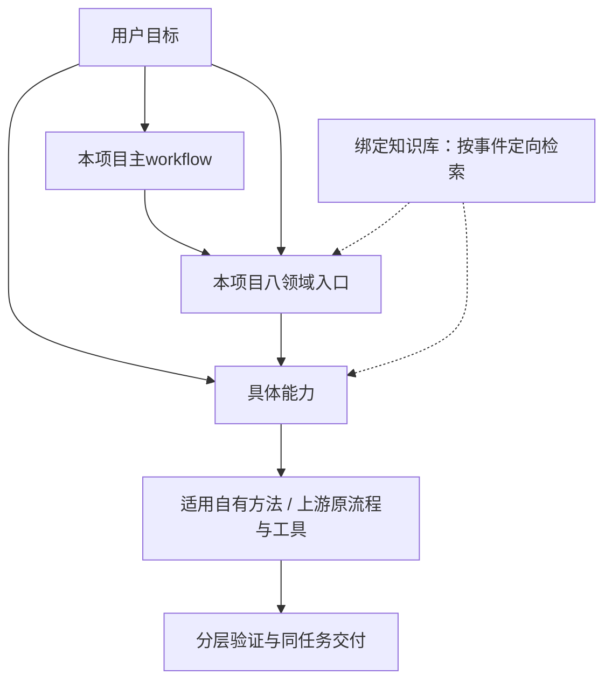

# vLLM-Ascend Agent 工作台项目框架

> 本文规定项目定位、维护归属、工作流程和验收标准。使用入口与准备步骤见 [README](../../README.md)，建设状态以开发计划为准，真实运行能力按实际环境验证。
>
> 配套规则为根目录 [AGENTS.md](../../AGENTS.md)。此仓库是项目维护源，可在合适路径克隆。每位使用者按用途准备业务代码、身份与执行环境；个人接入状态保存在本机初始化报告，不作为其他机器的运行前提。

## 1. 项目定位与目标

项目名：**ascend-agent-workbench**。用户在 Codex 中打开该仓库，以自然语言提出目标。主 agent 查证事实、澄清必要问题、选择 skill、动态分工、协调执行、整合证据并交付结果。

覆盖算子替换与开发、问题单定位、模型性能优化、模型精度问题、模型适配、部署与 profiling、CI/PR 排查、源码学习，以及从真实工作中开发可复用 skill。算子替换是首个流程演练案例，不是项目的唯一用途。

重点解决：

1. **性能优化缺少依据**：把现象、瓶颈假设、改动、对照实验与结论连起来。
2. **验证遗漏**：按接口、业务场景和实现分支形成覆盖矩阵，提前验证并明确缺口。
3. **CI 反复打断开发**：关联具体提交、检查、失败原因、修复与审核，便于跨会话继续。

采用 **项目规则 + 自有 skill + Markdown 模板 + 已有工具**。不以自研任务管理程序、数据库、agent 运行器、GUI 或第二套远程执行与 NPU 调度系统为建设前提。脚本按实际需求增加。

## 2. 已确定的建设决策

| 编号 | 决策 | 具体含义 |
|---|---|---|
| D01 | 通过 Codex 使用项目 | 验证项目 skill 可发现或显式读取 |
| D02 | 一个独立目标通常对应一个主会话 | 澄清、执行、交付衔接；中断后从文件恢复 |
| D03 | 尽量复用 workspace，不修改维护源 | 组织和消费能力；改进建议留在上层 |
| D04 | 接入 cannbot-skills | 按任务选用，不全量运行所有流程 |
| D05 | Matt Pocock 是方法来源 | 按需借鉴 grilling、拆分和交接，记录来源 |
| D06 | 首版采用轻量方案 A | 不预建 Python 系统、JSON Schema 或状态服务 |
| D07 | 动态划分子 agent | 围绕问题和依赖分工，不固定算子团队 |
| D08 | 默认权限采用 B | 明确范围内连续执行；提交、推送、发布前审核 |
| D09 | 反馈关键判断 | 展示证据、假设、选择、风险和下一步 |
| D10 | 重要取舍由用户决定 | 改语义、缩范围、接受必需场景退化或降低验收标准时等待决定 |
| D11 | 分阶段验证，矩阵可浏览 | 基础正确性、逐轮回归、完整验收；摘要与详细证据分开 |
| D12 | 任务结束后回顾 | 提出候选，确认后建设公共脚本或新 skill |
| D13 | 文档职责写入 AGENTS | 多会话共享唯一状态和维护入口 |
| D14 | 先演练，再做真实验收 | 不要求取回其他机器的历史资料或重跑旧任务 |
| D15 | 定位和修复按目标区分 | 定位交付证据与建议；明确要求修复/优化/实现时推进变更 |
| D16 | 标准初始化覆盖代码与 GitHub 接入 | 核对或准备 vLLM、vLLM-Ascend、Git 作者、GitHub 身份与 PR 工作条件；复用已有配置 |

服务器、模型、版本、shape、误差阈值和性能指标属于任务输入。后续架构变化记录原因和影响，不由某个会话静默改变。

## 3. 分层与维护归属



主workflow组织目标和跨域任务；领域入口维护场景/来源选用及结果检查；具体能力保留有效方法与适配。可从三层任一位置开始，复用上下文，不完整回跑主入口或创建另一套任务。目录/角色见[当前功能索引](../../README.md#按任务选择入口)，细节由[分层协作](../guides/skill-routing.md)维护。

领域固定由项目维护，完整原skill可以作为域内子流程。已验证适用的自有能力优先，缺口核对上游后补位；选择性融合方法与项目改进，脚本/模板/工具尽量原用。领域覆盖不足时按现有发现协议查已登记来源，目录不是白名单。

每个消费方只登记真正使用的来源/资源；候选和治理检查对象不成为全量运行依赖。方法、原接口、历史参考依据及当前实际验证分开，更新比较两类差量并复查旧适配，见[消费与升级约定](upstream-consumption.md)。来源锁/下层声明与原执行/provider/身份/设备状态仍是事实源，不新增pin、调度或资源系统。

知识是跨领域经验输入，首次目标、新错/重复失败、转向和适用前提变化时查询/复核；已有结果交接复用，不每层重搜。私有知识正文/索引不随公共skill发布；知识不能扩大授权或替代当前运行证据。

重构或升级先在隔离候选中验证，不让当前使用方读取半成品。最终迁移更新引用/接入并删除旧位置兼容，不维护旧名别名或双份正文。方法可读、工具可调用、真实NPU/业务验收分别报告。

## 4. 仓库布局与文档职责

```text
ascend-agent-workbench/
├── AGENTS.md
├── README.md
├── .gitignore
├── .gitmodules
├── .agents/skills/          # 自有 skill；完整入口与用途见 README
├── .codex/                 # 本机客户端接入配置；生成配置按既有忽略约定留本机
├── docs/
│   ├── README.md            # 四类文档的完整导航
│   ├── guides/             # 使用与执行规范
│   ├── tools/              # 公共工具说明
│   ├── maintenance/        # 项目框架、开发计划/记录与验证说明
│   └── templates/
│       ├── 任务说明.md
│       ├── 实验记录.md
│       ├── 验证矩阵.md
│       ├── CI记录.md
│       └── 交付与回顾.md
├── tasks/<YYYY-MM-DD>/<事项名>/  # 长期任务与模型分析按统一材料规范分流
│   ├── 任务说明.md          # 状态、结论、下一步与材料入口
│   ├── scripts/             # 按服务/实验保存完整脚本
│   ├── configs/             # 同编号的实际配置
│   ├── logs/                # 按编号、采集批次、节点组织；精度分析有远端例外
│   └── results/             # 按编号组织结果，详细任务记录和 assignments 也在此
├── records/                 # 容器、服务器快照、三类正式测试表，忽略提交
├── knowledge/               # 外部私有知识库接入协议与通用模板
├── scripts/                 # 确认建设的公共工具
├── tests/                   # 工具需要测试时增加
├── config/
│   ├── workbench.example.yaml
│   └── workbench.local.yaml # 忽略提交
├── upstream/
│   ├── sources.lock.yaml
│   └── skill-mapping.md
├── deps/                   # 只读来源；路径与版本见 sources.lock.yaml
├── repos/                   # 默认业务代码 checkout，忽略父项目提交
│   ├── vllm/
│   └── vllm-ascend/
└── .workbench-local/        # 忽略提交：缓存、临时文件、大型产物
```

这里展示目录职责，不重复枚举全部 skill 或依赖；完整入口见 [README](../../README.md#按任务选择入口)，固定来源见 [sources.lock.yaml](../../upstream/sources.lock.yaml)。空目录不需用占位文件强行提交；不先建立 `src/`、`contracts/` 或 `pyproject.toml`。本项目路径不写成 skill 在其他主机上的固定运行前提。

目录写入边界以[根规则的职责表](../../AGENTS.md#2-目录职责与事实源)为准；新增文件归位、新增或调整目录及移动文件后的同步维护，遵循[根规则的开发要求](../../AGENTS.md#11-工作台开发与文档维护)，本文不另维护一套准入规则。

[文档导航](../README.md)串联使用规范、工具说明、维护约定、模板及跨目录的skill/来源/知识入口。框架保留架构边界与建设标准，操作步骤由相应skill和专题规范维护。工作台开发先读[当前事项](开发计划.md#当前待办与待验收)，再定向读相关章节和变更；仅在追溯决定时读关联历史。

任务说明是业务状态的唯一入口，全局计划和开发记录分别维护工作台建设状态及变更事实。资料不一致时按[会话查证规则](../../AGENTS.md#3-会话开始与中断恢复)核对用户决定和实际证据，修正权威位置。

## 5. 依赖接入与能力核对

外部来源按固定提交接入 `deps/`，业务代码绑定独立的实际 Git 根。来源取得、skill发现、工具调用和目标环境就绪分别核验；原身份、provider和运行状态由原工具维护。完整接入与升级由[工作台维护领域](../../.agents/skills/ascend-workbench-maintenance/SKILL.md)组织，各步骤使用对应原能力。

来源用途与准备命令见[README](../../README.md#按用途准备领域来源)，顶层身份与版本见[sources.lock.yaml](../../upstream/sources.lock.yaml)，定位与发现见[能力映射](../../upstream/skill-mapping.md)。本机选择和路径按[配置约定](../../.agents/skills/ascend-workbench-init/references/config-schema.md)维护；框架不复制版本、配置字段或完整操作清单。

### 5.1 标准初始化：准备后续开发条件

[初始化skill](../../.agents/skills/ascend-workbench-init/SKILL.md)统一组织模式选择、上下层清单和本轮必要信息，集中确认后实施。标准开发接入覆盖业务代码与GitHub/PR条件；轻量准备及远程能力按实际目标选择。已有明确选择直接复用，不能因只收到部分答复便开始本轮初始化实施。

具体确认项、副作用边界及执行步骤只在[初始化操作约定](../../.agents/skills/ascend-workbench-init/references/operations.md#实施前确认)维护。代码路径优先复用现有checkout；选择独立clone或workspace业务子模块时，每个实际目标仍只有一个准备入口。

### 5.2 初始化结果与重复执行

[一份本机报告](../../.agents/skills/ascend-workbench-init/references/operations.md#一份本机报告)记录实际路径、版本、就绪项、缺失项和待决定项。源码可读、客户端发现、实际工具调用与目标运行分别列证据；报告存在不能证明它们已就绪。客户端接入按[实际发现与联接](../../.agents/skills/ascend-workbench-init/references/operations.md#当前客户端的skill发现与接入)核对，不把clone完成当成界面接入完成。

再次执行按现状只补已授权缺项；工作台更新后的接入差异走[增量检查](../../.agents/skills/ascend-workbench-init/references/operations.md#增量检查与补齐)。不因代码更新重做初始化或重复登录。

### 5.3 依赖变化与日常检查

代码安全同步交[repository-update](../../.agents/skills/ascend-repository-update/SKILL.md)，固定来源检查与升级交[dependencies](../../.agents/skills/ascend-workbench-dependencies/SKILL.md)。日常任务只核对实际使用前提，实验保持明确基线；工作台同步、依赖升级和业务代码切换分别处理。

消费类型、两类差量、能力增强评估、适配清理及回退以[消费与升级约定](upstream-consumption.md)为准。纯方法改进和实际执行环境升级按各自影响验证，不把检查结果当成采用或发布授权。

### 5.4 传递依赖：检查到实际使用的完整链路

父版本的原声明约束实际使用的下层能力；上层只锁定顶层选择，不另造下层pin。核对范围沿相关消费关系展开，覆盖以下边界：

| 类别 | 架构边界 |
|---|---|
| 原执行工具与协议 | 核对候选父提交声明和实际接口，继续使用原身份与状态 |
| 可选测试依赖 | 只在对应测试启用时准备，不把它当成全部业务的运行依赖 |
| 业务代码组合 | vLLM/Ascend按自身CI声明与任务基线配对，不随skill升级自动切分支 |
| 任务运行环境 | 按真实工具、芯片及任务需求核对，不因资料源更新就升级整套环境 |

依赖节点、循环/冲突、缺声明及候选切换的处理步骤见[依赖检查约定](../../.agents/skills/ascend-workbench-dependencies/references/dependency-check.md)。递归的是相关约束，不是无条件下载所有生态仓库；不能把各仓最新main当作兼容组合。

### 5.5 上层与下层初始化的组合

上层init整合一份计划，下层只承担已指定步骤；同一目标、期望变化和环境绑定唯一执行方。上下文共享不代表共享身份，不把每层skill读取变成新agent或通用函数接口。

[操作归属](../../.agents/skills/ascend-workbench-init/references/operations.md#操作归属)及[一份本机报告](../../.agents/skills/ascend-workbench-init/references/operations.md#一份本机报告)维护去重键、操作表、状态与恢复条件。下层整套流程会准备未选目标时，选择已有定向入口；没有适用入口则报告具体缺口，不另造维护副本。只读查询与有副作用的probe按实施前确认边界区分。

## 6. 自有skill与领域路由

当前名称、用途和说明统一见[项目功能索引](../../README.md#按任务选择入口)；具体场景、来源与输入前提归所属领域及其reference，框架不复制另一张优先级表。主入口保持目标组织，领域入口始终由本项目维护，原完整skill可在域内作为子流程。

技能应有准确的输入、输出、边界及直接启动方式；知识查询和已有上下文按共用约定复用。候选评估由candidate-review收敛，已授权开发由skill-development实施；不为每个原技能建同义包装。原个人skill不存在时核对已登记替代或报告缺口，不将个人安装当公共前提。

借用实质方法/模板/工具记录来源、资源、参考依据与适配，原许可保留；代码和运行验证按本轮影响执行，不以目录、版本或格式检查代替真实路径。更新后复查自有差异和旧例外，精确消费事实按[声明约定](upstream-consumption.md)维护。

## 7. 通用工作流与权限

流程为：**目标与事实 → 验收条件 → 计划与分工 → 调查/实验/实现 → 整合验证 → 审核交付 → 回顾**。证据否定假设时返回调查；重要目标改变时明确新的取舍。

### 7.1 默认执行范围

目标、已有授权和验收条件约束执行范围。分析与实施、必要任务记录与业务变更、实现与提交发布分别判断；具体边界及“提交”的项目含义由[根规则](../../AGENTS.md#4-授权与关键判断反馈)唯一维护，Git上传大小策略见[验证说明](validation.md#git-推送大小配置)。

### 7.2 关键判断反馈

反馈服务于用户判断：说明证据、选择理由、风险和下一步验证。路线改变、回归失败或验收缺口及时反馈；是否需要等待决定遵循根规则，不把阶段反馈变成逐步审批。

## 8. 动态分工与多会话一致性

按独立产物、依赖和复核价值组织职责，不建立固定常驻团队。常见分工示例：

| 场景 | 可能的分工 |
|---|---|
| 算子替换 | 语义/接口分析、AscendC实现、独立验证 |
| 分布式问题单 | 复现与环境、各rank证据、通信/调用链假设验证 |
| 模型性能 | 工作负载与基线、profiling分析、方案与对照测量 |
| 模型精度 | reference/输入核对、中间结果定位、修复与回归 |
| CI失败 | run/workflow、依赖/构建、修复与复验 |

具体并发限制、assignment内容和写入归属见[动态委派规则](../../AGENTS.md#6-动态委派与写入归属)，计划组织见[planning](../../.agents/skills/ascend-task-planning/SKILL.md)。主agent统一整合任务状态与全局决定；隔离上下文或worktree不代表隔离NPU、端口和服务。工具不可用时由主agent完成，只有实际结果或明确阻塞才构成交付。

## 9. 任务记录与恢复协议

### 9.1 身份、状态与计划

一个任务只有一个当前状态入口和owner；task_id不因目录名或展示归并而变化。状态、计划修订及接手规则见[根规则](../../AGENTS.md#10-状态交接与任务回顾)，字段沿用[任务说明模板](../templates/任务说明.md)。

目录、服务启动材料、日志和服务器/容器/正式测试表只按[材料规范](../guides/task-records.md)维护。表项是环境或运行的带时间记录，不替代任务当前状态；历史目录和证据不自动迁移。

### 9.2 实验与证据

关键实验保留假设、实际条件、对照和结果的对应关系，失败及无定论也可追溯。记录结构见[实验模板](../templates/实验记录.md)，证据分层见[根规则](../../AGENTS.md#7-性能实验与证据)。原始大材料保留实际入口，摘要不能把不可访问或历史证据写成当前已核验。

### 9.3 中断后继续

从任务说明和最新交接恢复，核对当前代码、计划、授权与底层运行，再判断旧证据可复用范围。恢复材料及资源核查按[review的交接流程](../../.agents/skills/ascend-task-review/SKILL.md#交付与恢复)执行；不以目录猜底层身份，不因聊天中断重复启动未知服务。

## 10. 性能优化与问题调查

### 10.1 有依据的优化闭环

每轮按 **观察 → 假设 → 改动 → 可比实验 → 结论** 推进。空泡、访存、计算、同步、CPU 调度或通信瓶颈由适用 profiling 和代码证据支撑，不因 trace 有空白就直接断言原因。

优化前确定指标、基线、生产工作负载、测量方式、重复/交替策略、波动判定和运行预算，优先复用已有领域实验流程。无法查到的目标取舍再问用户，不编造通用阈值。

逐轮列失败、退化和无定论结果，避免只汇报最佳一次。候选和基线记录实际代码、设备、软件、模型、并发、输入与测量设置；明显混杂或环境不一致时不作收益结论。

同一失败无新增证据时先修正实验方法；多轮无收益时重新判断假设并反馈，不靠无限试改或盲目重跑。具体时间/设备/轮数预算属于任务约束；预算不够则明确阶段交付和未完成项。

### 10.2 场景分别验收

| 类型 | 核心问题 | 不能替代最终结论的证据 |
|---|---|---|
| 算子优化 | 语义与性能是否满足目标矩阵 | 不可用选出的最佳 shape 代表全部必需场景 |
| 模型性能 | 端到端目标指标与资源变化 | 不可用单算子加速代表模型吞吐或延迟收益 |
| 问题单定位 | 根因、触发条件、影响范围及证据强度 | 不可用“改后没出现一次”直接认定根因 |
| 精度问题 | reference、输入和误差标准，以及偏差所在路径 | 不可用一次输出接近或随意放宽阈值代表正确 |
| 服务部署 | 目标服务是否完成真实请求 | 不可用进程存在或 health 正常代表推理完成 |

源码学习与纯规划按其目标交付，不强行补真实运行。

### 10.3 算子性能默认规则

生产 shape 是主要优化目标，逐项列收益和退化。泛 shape 满足声明的正确性和安全要求，性能也记录，但不默认要求所有泛 shape 加速。

支持范围、dtype、格式、布局、属性、alias/writeback、数值舍入等以原逻辑和实际接口为准。必需场景退化、需要缩范围或改变数值语义时，交给用户决定。

上述是算子默认规则。模型性能另按任务工作负载定义 TTFT/TPOT、吞吐、时延、资源等实际目标，不套用算子 shape 判定。

## 11. 验证阶段与可浏览矩阵

### 11.1 三阶段验证

1. **初版后**：核对原语义、接口、误差标准与基本正确性，通过后再开始性能优化。
2. **每轮优化后**：检查受影响路径、关键生产用例与边界回归；失败时不能验收性能优化。
3. **最终交付前**：执行完整的必需矩阵与集成回归，明确失败、未跑和不适用。

阶段安排按任务选用。问题定位先证实复现与假设，修复再做回归；纯分析按其交付物验收。模型精度按reference与输入确定检查点，模型性能同时需要正确性与端到端测量。

### 11.2 摘要、详细用例与证据

实现早期形成可浏览的覆盖摘要，随后按变更修订；开发者可补充，独立复核检查reference、覆盖与关键结论。生产场景、分支/边界和集成按风险与等价覆盖组织，详细参数及结果通过case/run引用。

字段和记录格式见[验证矩阵模板](../templates/验证矩阵.md)，完成判断见[根规则](../../AGENTS.md#8-验证矩阵与验收)及[review](../../.agents/skills/ascend-task-review/SKILL.md#检查矩阵与-ci)。一页是阅读目标，不能据此删必需用例；推导输入、模拟和真实运行必须区分。

## 12. CI、PR 与版本关联

CI证据绑定真实repo、候选head和run，修复后重新关联，不能沿用旧提交的成功状态。先读实际workflow与失败job，分类和重跑均有依据；没有终态就保留等待或缺口。

业务仓预检按[共用约定](../guides/business-ci-preflight.md)，对象、现象、分类、修复、授权及复验字段只在[CI记录模板](../templates/CI记录.md)维护。提交/推送沿用具体授权，合入与远程/NPU验收分别记录。

## 13. 交付、回顾与公共工具

### 13.1 交付与交接

任务说明提供当前结论和接续入口；需要独立正文时用[交付与回顾模板](../templates/交付与回顾.md)。[review](../../.agents/skills/ascend-task-review/SKILL.md#交付与恢复)按实际目标核查结果、缺口、owner、基线、运行与资源，材料检查见[统一规范](../guides/task-records.md#交付检查)。接手者应能从这些入口继续，不依赖完整聊天。

### 13.2 每个任务回顾，但不强行产出工具

回顾说明有效/无效假设、重复探索、返工或覆盖问题。需要留存的专用脚本和证据归本任务，调用原工具只保留条件与结果入口；没有可复用候选时无需新增skill或公共脚本。

### 13.3 候选到公共脚本或 skill

[候选评估](../../.agents/skills/ascend-skill-candidate-review/SKILL.md)判断实际价值、已有覆盖、边界和维护成本；用户确认范围后由[skill开发](../../.agents/skills/ascend-skill-development/SKILL.md)实施。评估与待决定项留本机任务，已确认建设进入开发计划，实际修改进入开发记录。没有新证据不重复推荐已拒绝项。

公共脚本按实际操作选择语言，提供用途、输入输出、参数、退出/失败行为和适用验证；不因任务里已有脚本就直接推广。公共skill保留相应README、调用方及[消费声明](upstream-consumption.md)，来源与许可不能省略。

### 13.4 每日归档、知识维护与授权发布

个人归档、知识维护及两类发布分别按[每日同步说明](../guides/daily-sync.md)执行；知识正文和维护规则由[绑定的私有库](../../knowledge/README.md)维护。运行时知识触发见[分层协作](../guides/skill-routing.md#知识在业务运行中的触发)，各入口复用有效查询。

任务进度、调度、日报/周报和回执留本机。知识候选按具体用途与证据逐条提出，由用户决定收录；日常维护或发布授权不代替未确认候选的决定，也不把知识candidate自动变成公共工具待办。

### 13.5 开发产物的跨机器复用

从规划、参考选用到候选验收，统一执行[跨机器复用规则](validation.md#开发与发布的跨机器复用规则)。公开产物具备随仓材料或可获取的固定依赖，不携带本机原件及索引；真实任务环境保留在本机记录中。

验证按改动影响选择引用检查、代表行为或隔离候选运行，并说明其他平台与NPU缺口。检查方法只在验证说明维护，不另建一套发布规则。

## 14. 首批开发计划与完成标准

本节保留首版建设的历史基线与完成条件，不表示当前待办或完整能力清单；当前建设状态只在[开发计划](开发计划.md)维护。

| 编号 | 交付 | 依赖 | 完成标准 |
|---|---|---|---|
| B01 | 初始化仓库和五份入口文档 | 无 | AGENTS 导航、职责、权限与恢复一致；只建立已定范围 |
| B02 | 依赖、配置示例与来源映射 | B01 | 三个来源/提交可核对；实际读取方式可用；缺能力不冒充可执行 |
| B02a | init 与 dependencies skill | B02 | 支持复用/专用克隆，身份与每项修改有唯一执行方；输出分支/界面状态，按第 5.5 节核对去重、范围与恢复；检查相关传递依赖 |
| B03 | 五种记录模板与一个演练任务 | B01 | 身份、状态、计划、证据、覆盖、CI 和交接格式齐备，无重复事实源 |
| B04 | workflow 与 planning skill | B02a/B03 | 明确任务不过度追问；复杂任务能给出依赖与动态分工 |
| B05 | execution 与 review skill | B04 | 按授权推进；验收核对代码/环境/证据；中断能恢复 |
| B06 | skill-development 与回顾流程 | B03/B05 | 候选具体、有来源；普通任务不自动新增公共工具 |
| B07 | 首轮流程演练与修订 | B04/B05/B06 | 通过第 15 节场景；记录模拟范围和发现问题 |
| B08 | 下一项真实工程任务验收 | B07、目标环境可用 | 实际任务有真实运行/验证与对应 CI 证据，覆盖清楚 |
| B09 | 基于使用回顾建设确认的工具 | 对应候选已确认 | 有真实需求、验证与维护记录，不为完整性预建 |

B02/B03 可独立推进；不让不同会话各自设计任务格式。B01 建立工作台入口；B02a 完成标准开发接入，业务仓库和身份由同一初始化流程负责。B08 不预设必须是算子任务。

模板各自固定内容：任务说明维护目标/状态/计划；实验记录维护假设和对照；验证矩阵维护覆盖与结果索引；CI记录维护提交与 run；交付与回顾维护总体结论和交接。建仓不需要先补历史任务。

初期建设完成标准是入口可用、七个规划 skill 可按需读取、模板一致且流程演练通过；初始化能力分项报告。真实执行成熟度以 B08 为另一个里程碑；不能用 skill 文件齐全或演练通过冒称已经真实验收。

## 15. 第一轮流程演练

以用户提供的 Triton → AscendC 替换流程为背景：原逻辑与初版、profiling/空泡优化、生产与泛 shape 验证、框架集成、CI 修复与审核。公开 PR #17564 已合入；另一台机器的私有历史产物不作为演练前提。

使用明确标记的模拟结果和本地夹具，不声称执行过 NPU、真实 CI 或历史 benchmark。至少演练：

| 场景 | 检查点 |
|---|---|
| 初版与优化 | 基础正确性通过后才安排优化；假设、条件、结果可追溯 |
| 生产收益与泛 shape 失败 | 不以加速掩盖精度/边界失败；记录回归与决定 |
| CI 失败与新提交 | 分类有依据，先审核；旧 SHA 结果不误用于新 SHA |
| 同一文件/同一 NPU | 写入和测量不无协调并行 |
| 会话中断 | 新会话从状态和证据恢复，不重复未知运行 |
| 缺环境/缺资料 | 阻塞实际依赖项，本地工作继续，不编造结果 |
| 初始代码/身份缺失或已有配置 | 标准初始化能补缺失、复用既有状态；模拟登录不冒充真实 GitHub/PR 就绪 |
| 专用克隆、路径冲突与部分失败 | 新目录有独立 Git 状态、旧仓库保留；fork/版本来源可查；重试补缺失、不覆盖冲突或重复克隆 |
| workspace 与独立业务仓库初始化 | 选择适用下层流程和真实根目录，复用已定选择；已就绪不重复初始化，分支查询不创建 workspace 身份 |
| 上下层 init 去重与范围不匹配 | 同一登录/仓库操作只有一个执行方；专用 repos/ 不再准备 workspace 业务副本；不支持定向入口时报告缺口，不全量执行 |
| 重复 init、身份变化与中断重试 | 现状核对后跳过成功项；身份变化核对受影响权限；未知结果先查证，不盲目重复变更；升级不触发完整 init |
| 依赖升级或版本偏离 | 核对目标父提交的相关下层声明与接口；可选测试依赖不阻塞无关能力；不覆盖 dirty 内容或自动切业务分支 |

另用问题单定位、模型性能、模型精度三个短场景检查路由与交付条件，确认不被算子模板绑死。定位不自动变成修复；模型收益需要端到端证据；精度验收有明确 reference 与标准。

演练产物为任务说明、必要 assignment/模拟结果、矩阵摘要、CI 示例、交接和演练报告。报告列发现问题、修订与未覆盖范围。开发者能从摘要找到证据、从交接继续工作、区分模拟和真实，才算演练通过。

本节提供可复用的演练输入与判断标准；实际走查结果留各自本机任务，自动化合成回归见[验证说明](validation.md)。模拟场景与隔离行为走查不证明标准初始化或真实工程已经通过；真实任务仍需验证工具接入、设备协调、真实测量和 CI 闭环。

## 16. 任务中的具体输入与架构演进

每项任务查证或明确：实际分支/提交与 dirty 内容、环境和工具、模型与工作负载、支持范围、precision/reference、性能指标、资源预算、必须验证项、外部动作授权。可查事实由 agent 获取，无法查证则说明缺口；取舍才问用户。

缺少关键输入时先做不依赖它的工作，不擅自假设通过标准。不同任务可以有不同验收条件，不把一个算子的阈值或 shape 固化为项目全局规则。

需要新工具、多客户端、外部 tracker、GUI、全局安装或自动化循环时，从真实证据提出独立改进方案。架构变更同步 AGENTS、框架、计划和相关入口，并在开发记录写明原因、影响和验证。跨会话不能独立维护另一套规则。

评价改进观察重复探索、无效实验、覆盖遗漏、CI 返工、上下文增长和用户决策负担。无实际用量数据时只报告结构/字符数变化，不宣称 token 节省比例。

## 17. 参考与首版交付记录

- [Matt Pocock skills](https://github.com/mattpocock/skills)：本轮澄清使用 productivity/grill-me → grilling 的分轮决策方式。
- [workspace 维护上游](https://github.com/vllm-ascend-workspace/vllm-ascend-workspace)：本机 .agents/README.md 明确其维护归属；读取 skill 索引与相关接入规则。
- [cannbot-skills](https://gitcode.com/cann/cannbot-skills)：核对项目说明、领域能力与远端 HEAD；未据此声称其 skill 已安装或联合运行。
- [PR #17564](https://github.com/vllm-project/vllm-ascend/pull/17564)：用户首个案例，本轮 GitHub API 确认 MERGED；没有重跑其历史实验。
- [AGENTS.md](../../AGENTS.md)：来自用户确认的模板，作为本项目共用规则。

2026-10-05 的首版交付包括规则、七个项目 skill、模板、固定来源、映射与模拟演练；当时未完成业务与底层运行初始化或真实 NPU/CI 验收。以上仅为首版历史范围，不限制后续已实施能力。后续变化与当时验证见[开发记录](开发记录.md)，当前能力见[项目功能索引](../../README.md#按任务选择入口)，具体环境的就绪与验收仍按任务证据判断。

## 18. 版本记录

以下为框架文档版本，不对应工作台的Release标签；当前实现、发布和验收状态分别见开发计划与开发记录。

- 2026-10-31 / v4.0：形成主workflow、八领域、具体能力与共用模块的分层，支持三种启动、事件式知识检索和上游消费/吸收；操作细则收敛到对应事实源，历史建设与演练材料保留。
- 2026-10-30 / v3.2：明确实际消费上游流程和工具、本地deps副本约束、能力增强评估及旧适配退役；不改变当前固定版本或运行体系。
- 2026-10-05 / v0.1：初步讨论草案。
- 2026-10-05 / v1.0：曾提出较重的工具化结构，其中若干决策尚未澄清。
- 2026-10-05 / v2.0：根据 Q1–Q16 与目录职责要求重定基线：首版轻量、通用工程范围、只读复用依赖、动态分工、可浏览矩阵、CI 追踪、脚本回顾准入和多会话恢复。v2.0 替代前版初期建设方案。
- 2026-10-05 / v2.1：补充初始化与依赖维护职责，标准初始化覆盖 vLLM、vLLM-Ascend、Git 作者、GitHub 身份及 PR 工作条件；优先复用已有配置，明确能力缺口和业务代码位置。本次仍只修改规划文档。
- 2026-10-05 / v2.2：明确依赖升级覆盖相关传递依赖，按目标父提交读取约束，区分运行、可选测试、业务版本与环境；不全量拉最新，不建立第二套下层 pin。本次仍未执行实际升级。
- 2026-10-05 / v2.3：增加初始化后的仓库分支总览与刷新约定，区分本地路径、Codex 主/附加目录、原生 Git 操作目标与界面接入状态。本次未改变任何项目配置或代码分支。
- 2026-10-05 / v2.4：明确上层按状态组合下层初始化、实际路径与授权复用、探测副作用和统一结果；补充避免重复/循环初始化的建设与演练检查。本次仍只修改规划文档，未执行实际初始化。
- 2026-10-05 / v2.5：补充可选择的业务仓库专用克隆模式、fork/remotes、CI 配对、路径冲突与失败恢复；默认仍优先复用。本次只修改规划文档，尚未克隆业务仓库或实现初始化 skill。
- 2026-10-05 / v2.6：重整上下层 init 的职责表、业务路径唯一绑定、按现状合并操作、失败恢复与定向能力缺口；明确 init/升级不相互全量调用，并增加去重验收场景。本次仍仅更新框架与 AGENTS 模板。
- 2026-10-05 / v3.0：按用户授权将规划落为项目仓库，根 AGENTS 与本框架作为维护入口；增加项目级 skill、模板、固定来源、能力映射与模拟演练。标准初始化和真实工程能力分开验收。
