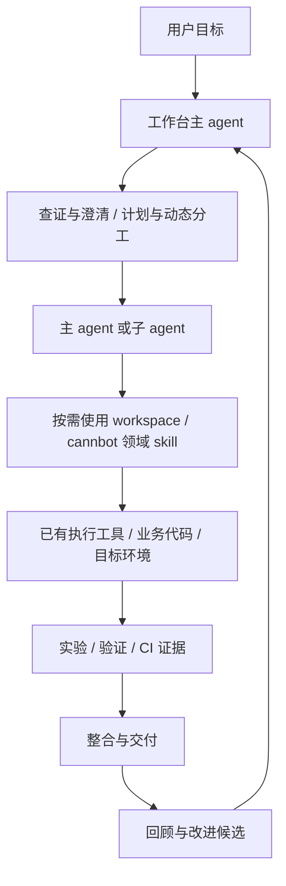

# vLLM-Ascend Agent 工作台项目框架

> 本文规定项目定位、维护归属、工作流程和验收标准。使用入口与准备步骤见 [README](../../README.md)，建设状态以开发计划为准，真实运行能力按实际环境验证。
>
> 配套规则为根目录 [AGENTS.md](../../AGENTS.md)。此仓库是项目维护源，可在合适路径克隆。每位使用者按用途准备业务代码、身份与执行环境；个人接入状态保存在本机初始化报告，不作为其他机器的运行前提。

## 1. 项目定位与目标

项目名：**ascend-agent-workbench**。用户在 Codex 中打开该仓库，以自然语言提出目标。主 agent 查证事实、澄清必要问题、选择 skill、动态分工、协调执行、整合证据并交付结果。

覆盖算子替换与开发、问题单定位、模型性能优化、模型精度问题、模型适配、部署与 profiling、CI/PR 排查、源码学习，以及从真实工作中开发可复用 skill。算子替换是首个流程演练案例，不是项目的唯一用途。

重点解决：

1. **性能优化缺少依据**：把现象、瓶颈假设、改动、对照实验与结论连起来。
2. **验证遗漏**：按接口、业务场景和实现分支形成覆盖矩阵，提前验证并明确缺口。
3. **CI 反复打断开发**：关联具体提交、检查、失败原因、修复与审核，便于跨会话继续。

采用 **项目规则 + 自有 skill + Markdown 模板 + 已有工具**。不以自研任务管理程序、数据库、agent 运行器、GUI 或第二套远程执行与 NPU 调度系统为建设前提。脚本按实际需求增加。

## 2. 已确定的建设决策

| 编号 | 决策 | 具体含义 |
|---|---|---|
| D01 | 通过 Codex 使用项目 | 验证项目 skill 可发现或显式读取 |
| D02 | 一个独立目标通常对应一个主会话 | 澄清、执行、交付衔接；中断后从文件恢复 |
| D03 | 尽量复用 workspace，不修改维护源 | 组织和消费能力；改进建议留在上层 |
| D04 | 接入 cannbot-skills | 按任务选用，不全量运行所有流程 |
| D05 | Matt Pocock 是方法来源 | 按需借鉴 grilling、拆分和交接，记录来源 |
| D06 | 首版采用轻量方案 A | 不预建 Python 系统、JSON Schema 或状态服务 |
| D07 | 动态划分子 agent | 围绕问题和依赖分工，不固定算子团队 |
| D08 | 默认权限采用 B | 明确范围内连续执行；提交、推送、发布前审核 |
| D09 | 反馈关键判断 | 展示证据、假设、选择、风险和下一步 |
| D10 | 重要取舍由用户决定 | 改语义、缩范围、接受必需场景退化或降低验收标准时等待决定 |
| D11 | 分阶段验证，矩阵可浏览 | 基础正确性、逐轮回归、完整验收；摘要与详细证据分开 |
| D12 | 任务结束后回顾 | 提出候选，确认后建设公共脚本或新 skill |
| D13 | 文档职责写入 AGENTS | 多会话共享唯一状态和维护入口 |
| D14 | 先演练，再做真实验收 | 不要求取回其他机器的历史资料或重跑旧任务 |
| D15 | 定位和修复按目标区分 | 定位交付证据与建议；明确要求修复/优化/实现时推进变更 |
| D16 | 标准初始化覆盖代码与 GitHub 接入 | 核对或准备 vLLM、vLLM-Ascend、Git 作者、GitHub 身份与 PR 工作条件；复用已有配置 |

服务器、模型、版本、shape、误差阈值和性能指标属于任务输入。后续架构变化记录原因和影响，不由某个会话静默改变。

## 3. 分层与维护归属



| 内容 | 维护源 | 上层的使用方式 |
|---|---|---|
| 分析、分工、记录、验收、回顾 | 新项目 | 自有规则、skill 和模板 |
| 领域流程、知识、运行工具 | workspace / cannbot / 外部提供者 | 固定来源，按需读取与调用 |
| 远程执行、session、设备与端口状态 | 现有底层工具 | 消费原有状态，保存关联引用 |
| 模型、算子和框架代码 | 实际业务仓库 | 绑定 checkout/worktree，遵守该仓库规则 |
| 澄清、拆分与交接方法 | Matt Pocock 上游 | 提炼到自有 skill，保留来源与许可 |

使用多个领域来源时，主 agent 明确分工。例如 workspace 负责运行与框架验证，cannbot 提供 AscendC 方法；具体按实际能力决定。不能同时运行两套编排流程管理同一资源。

依赖建议不能扩大用户授权。流程冲突先核对目标代码、环境和规则，记录选用方式；确实不能协调时只暂停受影响步骤，说明冲突。底层业务修复与改写 workspace 维护源是不同操作。

## 4. 仓库布局与文档职责

```text
ascend-agent-workbench/
├── AGENTS.md
├── README.md
├── .gitignore
├── .gitmodules
├── .agents/skills/          # 自有 skill；完整入口与用途见 README
├── .codex/                 # 本机客户端接入配置；生成配置按既有忽略约定留本机
├── docs/
│   ├── README.md            # 四类文档的完整导航
│   ├── guides/             # 使用与执行规范
│   ├── tools/              # 公共工具说明
│   ├── maintenance/        # 项目框架、开发计划/记录与验证说明
│   └── templates/
│       ├── 任务说明.md
│       ├── 实验记录.md
│       ├── 验证矩阵.md
│       ├── CI记录.md
│       └── 交付与回顾.md
├── tasks/<YYYY-MM-DD>/<事项名>/  # 长期任务与模型分析按统一材料规范分流
│   ├── 任务说明.md          # 状态、结论、下一步与材料入口
│   ├── scripts/             # 按服务/实验保存完整脚本
│   ├── configs/             # 同编号的实际配置
│   ├── logs/                # 按编号、采集批次、节点组织；精度分析有远端例外
│   └── results/             # 按编号组织结果，详细任务记录和 assignments 也在此
├── records/                 # 容器、服务器快照、三类正式测试表，忽略提交
├── scripts/                 # 确认建设的公共工具
├── tests/                   # 工具需要测试时增加
├── config/
│   ├── workbench.example.yaml
│   └── workbench.local.yaml # 忽略提交
├── upstream/
│   ├── sources.lock.yaml
│   └── skill-mapping.md
├── deps/                   # 只读来源；路径与版本见 sources.lock.yaml
├── repos/                   # 默认业务代码 checkout，忽略父项目提交
│   ├── vllm/
│   └── vllm-ascend/
└── .workbench-local/        # 忽略提交：缓存、临时文件、大型产物
```

这里展示目录职责，不重复枚举全部 skill 或依赖；完整入口见 [README](../../README.md#按任务选择入口)，固定来源见 [sources.lock.yaml](../../upstream/sources.lock.yaml)。空目录不需用占位文件强行提交；不先建立 `src/`、`contracts/` 或 `pyproject.toml`。本项目路径不写成 skill 在其他主机上的固定运行前提。

目录写入边界以[根规则的职责表](../../AGENTS.md#2-目录职责与事实源)为准；新增文件归位、新增或调整目录及移动文件后的同步维护，遵循[根规则的开发要求](../../AGENTS.md#11-工作台开发与文档维护)，本文不另维护一套准入规则。

| 文件或目录 | 唯一职责 | 更新时机 |
|---|---|---|
| AGENTS.md | agent 规则、目录导航、读写边界与恢复 | 共用工作规则变化 |
| README.md | 定位、安装、依赖准备和使用入口 | 入口或安装变化 |
| docs/maintenance/项目框架.md | 架构、职责、流程与建设标准 | 架构决策变化 |
| docs/maintenance/开发计划.md | 工作台自身待办、依赖与完成条件 | 建设任务启动、调整或完成 |
| docs/maintenance/开发记录.md | 工作台实际变化、检查和重要决定 | 实质修改后 |
| docs/templates/ | 通用记录格式 | 有证据的格式改进 |
| tasks/ | 各业务任务的状态、过程、证据和交接 | 关键决定、实验与交付 |
| records/ | 本机容器、服务器快照及性能/精度/SWE 三类正式测试表；不进入 Git | 实际使用/检查目标、变更容器或正式测试/接手登记 |
| knowledge/ | 外部私有知识库的通用接入与证据规范 | 初始化绑定本机 paths.knowledge_root，正文、索引和历史只在外部私有目录维护 |
| upstream/ | 来源、版本、领域映射 | 接入与升级 |
| config/ | 依赖定位与本机配置 | 接入变化 |
| scripts/、tests/ | 自有公共工具与验证 | 确认建设后 |
| deps/ | 只读外部维护源 | 显式升级后 |
| repos/ | 独立业务 Git 仓库，可按任务修改；也可配置到既有外部 checkout | 初次准备或业务任务改变时 |

全局计划只管理工作台建设，不承担所有业务待办。业务任务状态的唯一入口是该任务的 `任务说明.md`。全局记录引用任务，不重复抄写全部实验。全局待办只维护在开发计划，变更事实只维护在开发记录。

新会话先读 AGENTS；工作台开发再读开发计划和相关框架章节；业务任务读任务说明、最近交接与必要证据。首次使用补读 README。不每次读取所有历史、所有 skill 或全部日志。

文档不一致时先核对用户决定和实际证据，更新其权威位置，其他位置保持引用。不能只根据修改时间覆盖。关键状态改变和交接后立即更新记录，不等上下文耗尽。

## 5. 依赖接入与能力核对

`deps/` 中选定的来源仓库通过固定提交的 Git submodule 接入，便于迁移和回退；可选来源按启用能力准备。标准初始化同时核对并准备 vLLM 与 vLLM-Ascend 业务仓库；默认优先复用既有 checkout，也支持明确选择为本项目独立克隆到 `repos/`。业务仓库是独立 Git 仓库，不作为上层项目文件提交。

如果已有可用代码位于 workspace 的业务子模块中，直接绑定实际路径，不再重复克隆。上层不为取得代码而盲目递归初始化所有依赖；确需使用 workspace 子模块模式时，遵循其 repo-init 的初始化规则。保持 workspace 外层 skill/工具维护源只读，业务代码在明确授权的实际仓库中修改。

各来源的用途、启用条件与准备命令统一见 [README](../../README.md#按用途准备领域来源)；来源 URL、路径和固定提交统一维护在 [sources.lock.yaml](../../upstream/sources.lock.yaml)，真实领域入口见 [能力映射](../../upstream/skill-mapping.md)。框架不另维护一张版本快照或部分来源清单。

固定来源不是联合运行通过的证明。接入时核对真实 remote、提交可获取性和能力；新增或升级来源时更新 lock 与父仓库 gitlink，查看相关 diff，验证受影响部分并更新记录。个人 fork 不冒充维护上游；若提交只能从既有 fork 获取，明确记录。

配置示例至少列依赖路径、业务仓库定位、默认并发数、已有 provider 引用和产物目录。本机配置忽略提交，不放凭据，不复制底层服务器、模型、镜像和资源状态。首版由 agent 读取 YAML，不先建设配置解析服务。

执行前区分：资料可读、skill 可发现/读取、工具可调用、目标环境满足要求。目录存在不能证明运行能力。缺少远程工具或 NPU 只阻塞相关步骤，本地分析和规划继续。

workspace 的 remote-dev、coordinator 等外部依赖沿用原接入规则；不复制实现和租约状态，不假定 Python 脚本能调用会话中的 MCP 工具。上层记录底层 task/session/run/execution id，不冒用其身份或根据 cwd 猜测归属。

### 5.1 标准初始化：准备后续开发条件

标准初始化默认目标是本机代码开发、PR 及所选下层消费方式就绪，不只下载 skill。先核对上层与每个启用下层的规则、初始化入口、传递声明和平台前提，汇总所有适用必需信息，再集中确认并实施。范围区分资料/方法、本机身份、直接工具、任务协调、服务器和测试；默认禁用值不能替用户选择跳过下层，资料引用也不要求全量插件安装。已确认或已有可用配置直接复用。

开始任何初始化实施操作前，必须收齐本轮全部必需选择；只收到仓库方案等部分答复时继续等待，不能先准备代码再补问作者。确认期间允许只读探测、方案整理和必要记录，具体必需项及副作用边界以 [init 的实施前确认约定](../../.agents/skills/ascend-workbench-init/references/operations.md#实施前确认) 为准。此门槛适用于开始或恢复初始化实施，不要求重复询问已有明确选择或未启用能力。

| 初始化项目 | 必须核对或完成的内容 |
|---|---|
| 上层项目与 skill 来源 | 入口文档、启用依赖的实际来源/提交、项目 skill 发现或读取 |
| 下层初始化 | 每个来源的实际消费方式、适用入口/前提、现有状态与全部缺失选择；workspace 工具用途包含本机资源用户名/profile 与统一 alias |
| vLLM / vLLM-Ascend | 路径、独立 Git 根目录、版本、分支、dirty 内容；已有仓库复用，缺失仓库准备 |
| Git 提交作者 | 核对 user.name / user.email 与来源；缺失或需调整时确认后写仓库级配置，不改其他项目的全局身份 |
| GitHub 身份 | 核对 gh 是否可用、实际登录账号、计划使用的认证与权限；已有正确身份复用，缺失时引导官方交互登录并验证 |
| 仓库拓扑与 PR 条件 | 核对 origin/upstream、fetch/push 配置和 fork；已有配置保留，新的 fork/账号/拓扑取舍集中确认 |
| 版本组合 | 新准备的业务代码优先采用目标 vLLM-Ascend 声明的 CI-pinned vLLM；既有开发分支不自动切换，报告实际组合与偏离 |
| 底层执行能力 | 直接工具、协调与服务器分别选择和验收；源码/启动/枚举/实际调用/客户端发现分开，缺口不阻塞独立本地能力、不自动引入 WSL/协议迁移 |

Git 作者、GitHub 登录、Git 的认证通道与仓库推送权限分别核对，不能用其中一项存在来证明其他项。权限核对报告检查范围，不用实际提交/推送来试权限；凭据通过现有安全存储处理，不写入任务文档或要求粘贴到聊天。

正式初始化复用 workspace 的 repo-init 方法和适用 helper。例如 CI pin 解析器支持指定实际 vLLM-Ascend 路径，拓扑工具支持指定实际 repo。其整套 repo-init 假定 workspace 布局，不能在上层根目录直接运行并把子目录当成业务仓库。

优先核对 `vllm-ascend/.github/vllm-main-verified.commit`，旧版本再按解析器的 workflow/docs 回退规则处理。记录解析来源与实际 vLLM/vLLM-Ascend 组合；该组合不是所有后续任务必须跟随的永久分支。

已有 dirty 内容、额外 remotes、分支与认证配置保留。需要切换账号、分支、改 established remotes、创建 fork 或生成/上传 SSH key 时，纳入具体初始化方案并取得对应授权；本轮框架编写不执行这些操作。

#### 5.1.1 业务代码位置：复用或专用克隆

初始化支持复用已有业务路径，或按用户选择为本工作台准备独立 clone；两个仓库可以分别选择。业务路径唯一绑定，工作台与下层流程不重复准备另一套业务仓库。独立 clone 隔离代码与 Git 状态，不要求重新注册账号或重复登录。

具体路径、fork/remotes、CI 版本配对、目标冲突及失败恢复按[初始化操作约定](../../.agents/skills/ascend-workbench-init/references/operations.md)实施，本机字段按[配置约定](../../.agents/skills/ascend-workbench-init/references/config-schema.md)维护。既有目录和未提交工作保留；不能将共享旧 Git 状态的 worktree 当作专用 clone。

用户可直接提出：“初始化本工作台，为 vLLM 和 vLLM-Ascend 在 repos/ 下独立克隆，使用已确认 fork，按目标 vLLM-Ascend 的 CI 版本配对。”这是由[初始化 skill](../../.agents/skills/ascend-workbench-init/SKILL.md)处理的自然语言请求；不表示存在同名 CLI 命令或统一参数接口。

### 5.2 初始化结果与重复执行

输出本机报告到 `.workbench-local/init-report.md`，分别列资料/skill、代码、Git 作者、GitHub/PR、远程运行的已就绪、缺失和待用户决定项。记录实际版本和路径，不保存凭据。缺 GitHub 身份不能宣布 PR 就绪；缺 NPU 不妨碍本地代码准备完成，也不能宣布运行就绪。

报告包含“仓库分支总览”：仓库名称与实际 Git 根目录、主/附加目录归属、当前 branch 或 detached HEAD、short commit、未提交改动概况、tracking branch、查询时间。依赖仓另外标记声明版本与实际偏离。先核对 Git 根目录并去重，未初始化目录不能回落到父仓后冒充独立代码仓。

此总览是查询时快照；初始化后可在会话中请求刷新，开始业务任务、切分支、升级或恢复任务时核对相关仓库。不需要为了显示本地状态而默认 fetch；若显示 ahead/behind，注明基于缓存还是本次更新的远端引用。

Codex 接入区分 agent 可访问路径与界面项目配置。根据 [官方项目文档](https://learn.chatgpt.com/docs/projects)，本地项目可附加多个文件夹，主目录决定默认 Git 操作和规则/skill 自动发现；[审查面板](https://learn.chatgpt.com/docs/code-review#review-multiple-repositories)可切换已附加仓库的改动。将仓库克隆到 deps/ 或 repos/ 不等于已自动登记为界面中的独立仓库。

保留上层工作台为主目录，按需要把两个实际业务目录附加到本地项目。其他领域依赖由显式路由读取，无需全部加入界面。初始化报告记录是否已附加/尚待操作，不把本机配置完成当作界面配置完成；客户端接入有现成能力时消费，没有时给出具体添加路径与步骤。

原生 PR/worktree 操作针对主仓库，不把工作台的主仓库按钮误用于业务代码。业务操作由 agent 明确指定实际 repo/worktree，或在相应业务项目中进行。多仓审查能力不等于一个按钮统一切换所有仓库分支；首版不自建 GUI。

后续再次初始化只补缺失或已授权的变化，保留已用配置，不重复克隆、重置代码或要求重新登录。用户明确只做分析/资料准备时可以选择轻量模式，报告未准备的开发能力；标准模式仍覆盖两个业务仓库与身份。

### 5.3 依赖变化与日常检查

依赖维护 skill 共用 `upstream/sources.lock.yaml`，workspace 的内部依赖读取其原声明，不建立第二套 pin。检查实际版本/dirty、变化影响和适用能力，再给出升级与验证方案；获授权后执行并更新记录。

纯方法变更检查行为，脚本/参数/结果协议变更核对兼容，底层明确版本要求继续遵守。日常任务只核对本次使用的能力，不每次联网更新全部依赖；正式实验保持版本稳定，升级单独记录。升级上层领域依赖不自动切换业务任务分支。

### 5.4 传递依赖：检查到实际使用的完整链路

`ascend-workbench-dependencies` 同时覆盖直接依赖与其声明的传递依赖。升级 workspace、cannbot 等外层仓库时，读取目标提交的依赖声明、submodule 指针、实际使用 skill 的脚本/协议和相关环境约束，形成受影响依赖图，不能只检查外层 HEAD。

| 类别 | 当前实例或适用范围 | 处理方式 |
|---|---|---|
| 执行与协议依赖 | workspace 声明的 remote-dev、vaws-coordinator | 按目标 workspace 的声明核对 pin/接口和实际 checkout；复用原 status/bootstrap 接入，不重写维护源 |
| 测试依赖 | workspace 的 vaws-knowledge conformance kit | 相关知识测试/CI 才准备；其声明明确不是运行时依赖，缺失不阻塞无关任务 |
| 业务代码组合 | vLLM-Ascend 与其声明的 CI-pinned vLLM | 核对实际组合和目标 CI 声明；已有业务分支不随 skill 升级自动切换 |
| 任务环境约束 | 相关 skill 使用的 Python/DSL、CANN、torch_npu、镜像与芯片等 | 查证本任务所需兼容条件；不因升级资料仓就自动安装或升级整个运行环境 |

范围由本次升级影响和启用能力决定。递归读取可用声明，对重复节点去重、检测循环与冲突；未使用的可选能力记录为未启用，不递归下载所有生态仓库。声明或私有资料不可访问时报告具体缺口，不能猜测兼容或宣称全链路已核对。

每个相关节点记录父依赖、声明所在文件与父提交、用途/启用条件、期望约束、实际版本、拟用版本、核对结果和验证。底层声明是其期望约束的权威源；上层 sources.lock 保存顶层选择、声明引用及已核对快照，不手工维护另一套下层 pin。

升级方案列出受影响节点及处理顺序：先从候选父提交解析目标约束，准备所需下层版本，再验证脚本/协议与相关流程，最后切换已验证组合并更新来源记录。执行期间保留已用组合与回退信息，不破坏正在运行的实验和共享 provider 状态。

“更新下层依赖”指满足父版本声明和本次能力的兼容要求，不是把所有仓库拉到各自最新 main。允许的开发偏离记录实际版本、原因和检查；不把参考 pin 自动变成所有工作必须完全一致的门禁。版本冲突、必需接口不兼容或无法验证时，暂停受影响升级步骤，给出保留原组合、调整范围或进一步验证的选择。

使用业务子模块时核对实际 gitlink 与任务基线；.gitmodules 的 branch=main 不是自动升级授权。不能为了升级工具顺带执行业务子模块的 `submodule update --remote`。

### 5.5 上层与下层初始化的组合

`ascend-workbench-init` 是唯一总入口和计划整合者。下层 init 按计划承担指定准备步骤，不能各自重新解释“初始化整个项目”。调用 skill 指 agent 读取对应 `SKILL.md` 并使用实际脚本/工具，不假定统一函数接口，不要求每层另开子 agent。首版用现有配置与 Markdown 报告表达以下约定，不预建初始化运行平台。

#### 5.5.1 操作归属与唯一目标

| 操作 | 归属与执行规则 | 去重范围 |
|---|---|---|
| 工作台入口、配置、领域依赖 checkout、界面接入与总报告 | 上层组织；初始版本取已定来源，升级由 dependencies 流程处理 | 同一工作台及实际依赖路径 |
| GitHub 登录与认证通道准备 | 上层统一核对并安排一次；可委托适用下层步骤，委托后上层只验收 | 同一主机/服务、账号和认证通道；各仓库权限仍分别核对 |
| Git 作者、fork/remotes、业务 checkout 与 CI 配对 | 每个业务仓库绑定唯一实际路径，每项操作指定一个执行方；上层或下层执行后另一层只验收 | 实际仓库/工作目录与期望配置；不同仓库的必要本地配置不算重复 |
| workspace 身份、machine profile 与底层执行依赖 | 先列本轮下层用途与必需状态；工作区工具用途的本机身份/profile 不因未接服务器而省略，执行/协调按所选用途走原工具 | 原 provider/工作区及其声明；不复制第二套身份、pin 或资源状态 |
| 可选测试或特定任务环境 | 相关能力启用且确有缺失时准备 | 实际环境与本次能力需求；无关能力保持未启用 |

先解析实际根目录并去重，避免路径别名重复指向同一工作目录；远程路径带主机/容器等上下文，不能把不同环境的同名路径视为同一目标。不同 worktree 的工作目录状态分别核对；同一 GitHub 账号就绪也不能代表所有仓库都可推送。

业务路径由本机配置唯一绑定。选择专用 repos/ 或已有外部 checkout 时，workspace 作为 skill/工具来源，不再准备其重复业务子模块；选择 workspace 的业务子模块作为实际路径时，相关 clone/submodule、拓扑和版本步骤交给其适用流程，上层不另建 repos/ 副本。两个仓库采用不同接入方式时按各自路径分配步骤，不跑会准备另一套仓库的整套流程。

接入顶层 deps/ 时按已选 submodule 路径准备，不能无条件执行整个依赖树的 `git submodule update --init --recursive`，使 workspace 内业务仓库被连带克隆。确需递归的部分先核对本次启用能力与操作表，再限定目标；已有其他业务副本只报告其存在，不自动删除。

#### 5.5.2 先制定一次计划，再执行缺失步骤

1. 读取已定配置与上下层现状，逐个核对启用下层的初始化入口和相关声明，汇总本轮用途、必需状态与全部未定项。先采用适用只读查询；完整 probe 的身份写入等副作用须经过确认。
2. 在初始化报告中列出操作目标、期望状态、执行方、依赖、授权范围、就绪/待办状态与证据入口。多个上下层步骤需要同一操作时合并；同一项修改不并行委派。
3. 全部适用下层清单汇总后集中确认尚未决定的路径、身份/alias、拓扑/版本、工具/客户端与远程目标；传入已有选择与授权，收齐必需答复再实施。下层接受指定范围，已有明确授权不重问，新增必要选择先补充确认。
4. 仅执行待办。下层结束后核对实际路径、版本、变化和结果，更新同一报告；由实际状态证明完成，不能只凭旧报告跳过检查。下层内部记录仍留在其原位置，上层只汇总引用。
5. 重复初始化或失败恢复时重新核对相关现状，只重试失败/缺失项；已成功项保留，未知中断结果先查证。缺失只阻塞依赖它的能力，不从头再跑所有流程。

不支持指定范围或外部业务路径的下层 init，不能直接全量执行。优先使用已有定向 helper；没有可用入口时，明确能力缺口，提出复用 workspace 布局或上层适配的具体方案，不自动修改下层源码、绕过其必要检查或克隆第二套业务仓库。下层没有初始化 skill 时查实际 README/声明/工具，不自动创建新 skill。

本轮读取的 workspace `repo_init_probe.py` 会确保 `.vaws-local/workspace-identity.json` 中的持久身份，并可能查询 GitHub，不能当作纯只读分支查询。workspace profile 或 remote-dev/coordinator 接入有必要时走各自适用入口，不因需要其中一项就触发业务仓库的完整 repo-init。

下层可以按原入口准备本次必要传递依赖，重复目标继续合并，循环则报告。init 与 dependencies 复用同一现状与来源记录：初始化不自动升级已用版本，升级只补受影响的准备步骤，两者不相互调用完整流程。

本机保存 SSH 的发现与 NPU 筛选按 [init 操作约定](../../.agents/skills/ascend-workbench-init/references/operations.md#保存目标与-npu-接入)。仅探测真实保存目标，使用新鲜 board/NPU 证据；不可达、硬件未知与无 NPU 分开记录。探测不自动授权新建容器或部署池；平台/接口失败保留原结果和恢复条件，客户端文件写入不代表已接入当前会话。

## 6. 自有 skill 与领域路由

当前全部自有 skill 的名称、用途和使用说明统一见[项目功能索引](../../README.md#按任务选择入口)，领域能力与固定来源见[能力映射](../../upstream/skill-mapping.md)。本文只维护分层职责，不再复制部分 skill 清单或数量快照。

主入口保持简短；每个 skill 有明确输入、输出和边界，复杂细节按需读取。候选评估归 candidate-review，已确认的 skill 开发归 skill-development；正式创建或实质修改按其开发规范执行。

第一版只接入项目级 skill，不自动安装到全局，也不覆盖同名独立版本。借用的实质内容记录来源、版本、修改与许可；上游维护源保持只读。

| 任务 | 领域来源 | 上层组织的内容 |
|---|---|---|
| 算子替换与 AscendC 开发 | 原实现；cannbot 的开发、tiling、同步、精度、review；workspace 的运行和验证 | 语义、性能目标、覆盖与资源协调 |
| 问题单定位 | 源码、日志、复现；workspace 的 graph/distributed/operator 等适用诊断 | 现象、假设与根因证据 |
| 模型性能优化 | benchmark、profiling collection/analysis、memory profiling、performance regression | 工作负载、基线、瓶颈与端到端收益 |
| 模型精度问题 | 独立 ascend-model-accuracy；correctness、graph/distributed/operator 和适用 cannbot 精度方法 | 症状路由、reference、消融与首个分叉、修复/规避判定及目标回归 |
| 部署与服务验证 | serving / pd-serving、既有跨环境部署 skill | 目标与真实请求验收 |
| CI/PR | 当前 workflow、具体 run、提交与 review | 分类、修复范围与复验 |
| 源码学习 | 既有 ascend-source-walkthrough | 连续调用链与阶段学习 |

精确 skill 名称和路径在锁定版本下核对，写入 `upstream/skill-mapping.md`。找不到专用能力时调查实际入口，不发明命令。通用路由不能用某个领域 skill 的结论替代本任务验收。

Matt Pocock 的 grilling 用于有影响的未知决策，拆分与交接方法按需适配。明确的小任务不过度采访，不照搬所有任务一律 TDD 或每个 agent 一个容器的假设。

## 7. 通用工作流与权限

流程为：**目标与事实 → 验收条件 → 计划与分工 → 调查/实验/实现 → 整合验证 → 审核交付 → 回顾**。证据否定假设时返回调查；回归失败时停止相应性能结论；重要目标改变时等待用户决定。

### 7.1 默认执行范围

- “定位、分析、审查”：交付证据、结论和修复建议；可在隔离环境验证假设，不自动把业务修复纳入交付。
- “修复、解决、优化、实现”：在已定范围内修改和验证，提交、推送、发布前审核。
- 任务文件的必要记录属于流程，不等于修改被调查代码；显式要求完全不写文件时遵守。
- 常规查证、明确范围内的实现和验证连续推进。
- 改变数值语义、缩小支持范围、接受必需场景退化、降低验收标准或扩大授权时，准备证据、选项和建议后等待决定。

CI 每轮修复默认先完成改动和验证，再审核提交/推送。第一次推送批准不授权无限后续推送。用户可以针对某个 PR 限定自动修复范围；记录范围和停止条件后执行。

本项目用户说“提交”时，即授权将本轮已明确修改提交并推送到远端 `main`，无需再确认是否推送。提交范围、作者/DCO和验证仍需核对；Git上传大小仅在本机配置 `git.push.max_upload_bytes` 为正整数时按[配置约定](validation.md#git-推送大小配置)检查，缺省或null不限。推送后核对远端 SHA；该约定不包含强制推送、合并 PR 或修改 PR 描述。

### 7.2 关键判断反馈

反馈包含证据、当前假设、选择理由、风险/替代方案和下一步，不公开内部逐步思维链。路线变化、假设被推翻、性能退化、精度失败、CI 原因变化和验收缺口及时反馈。

一般反馈后继续推进；只有需要用户决定时明确等待。不要把“你能看到判断”变成“每一步都需要批准”。

## 8. 动态分工与多会话一致性

可复用职责包括目标分析、源码调查、环境/复现、实验设计、实现、独立验证、CI 排查与整合；它们不是固定常驻团队。

| 场景 | 可能的分工 |
|---|---|
| 算子替换 | 语义/接口分析、AscendC 实现、独立验证 |
| 分布式问题单 | 复现与环境、各 rank 证据、通信/调用链假设验证 |
| 模型性能 | 工作负载与基线、profiling 分析、方案与对照测量 |
| 模型精度 | reference/输入核对、中间结果定位、修复与回归 |
| CI 失败 | run/workflow、依赖/构建、修复与复验 |

只在独立工作或独立复核收益足以抵消协调成本时委派。默认一层、最多三个同时运行的子 agent，受实际工具限额约束。相关的全链路问题可由同一 agent 处理；工具不可用时主 agent 完成并说明限制。

assignment 至少写明：任务 id、计划版本、目标、必要事实与资料入口、已定约束、代码/环境基线、允许修改范围、依赖、资源需求、完成标准、结果位置。只读 assignment 可写自己的结果文件，不可写业务源码。

子 agent 只写分配内容。主 agent 是任务说明、整体计划、全局决策和最终报告的唯一整合负责人。同一任务多会话不得各自更新整体状态；转移责任时记录当前负责人和时间。

交叠源码写入串行或隔离 worktree 后整合验证。NPU、端口和服务由底层协调，同一 NPU 的性能测量不能因上下文隔离而并行污染。

结果只返回主要结论、改动、验证、证据入口、限制、下一步及底层身份引用。原始日志与源码保留在可访问位置。若工具只能完整继承上下文，记录限制，不宣称已经节省 token。

“已启动”不是完成；终态必须有实际结果或明确阻塞。独立验证检查覆盖与关键结论，工作量按风险选，不无理由重复所有实验。

## 9. 任务记录与恢复协议

### 9.1 身份、状态与计划

任务目录、模型分析例外、编号、启动文件、日志和本机台账按[统一材料规范](../guides/task-records.md)维护。任务说明是每个事项的状态和材料入口，每日索引与台账只关联它。原有历史目录不因新规则自动迁移。

服务器表是原来源的带时间快照。正式性能、精度和 SWE 测试各用独立字段表；接手手动正式运行无表项时先补登记，调参排障留任务。算子开发同时维护任务进度和每轮实际运行的完整日志，沿用原工具所需状态，不复制另一份整体进度。

task_id 是稳定身份，不要求与归并后的目录名一致，既有 task_id、状态、owner 和证据含义保持不变。事项任务说明开头固定列：`task_id`、`status`、`owner`、`plan_revision`、`updated_at`；时间带时区，展示用 Asia/Shanghai。

正文包含目标/排除项、用户授权与决定、来源代码、环境/能力、验收项、带 id 的子任务与依赖、关键约束、当前阻塞和下一步。代码记录 repo/worktree、commit 与影响任务的 dirty 内容；环境至少引用设备/软件/模型/拓扑中本任务相关条件。

计划修订递增 revision 并记录原因。子任务写负责人、输入引用、写入范围、资源需求、完成标准、状态和结果引用。依赖必须无环，结果绑定计划版本，旧结果是否可复用需说明依据。

状态使用 `new / clarifying / planned / running / reviewing / completed / blocked / failed / cancelled`。正常路径按顺序推进，目标明确可省略 clarifying；只读与规划任务按其交付物验收，不要求 NPU 运行。子任务可 skipped，但有原因，不替代必需验证。

blocked 写清恢复条件，不相关工作继续；恢复时核查条件后回到适用状态。失败重试保留原失败及新尝试，不覆盖。completed 必须满足当前模式全部必需验收；新增范围明确重开并修订计划，或建立新任务。

### 9.2 实验与证据

每个关键实验有稳定编号，记录假设、预期观察、改动、代码/环境、输入/工作负载、命令/配置、基线与候选、run/manifest 引用、结果、结论和下一步。

结论区分事实、推断和未确认。证据引用注明来源、版本和位置；不可访问资料标记 unavailable，不当作已查证。大型日志和 profiling 原始数据不写进摘要；保存可访问路径与关键片段位置。

### 9.3 中断后继续

1. 读任务说明与交付/交接的最新状态。
2. 核对实际业务 dirty 内容、当前提交、计划 revision 和底层运行状态。
3. 判断哪些旧证据仍对应当前条件，哪些需要重跑。
4. 明确接手负责人和就绪子任务，从下一步继续。
5. 不因会话中断重复启动未知服务、重复占用 NPU 或丢弃失败记录。

工作目录不是底层身份。保存底层 task/session/run/execution 映射；资源清理以实际进程和底层状态为准，不以聊天结束或上层 completed 为准。

## 10. 性能优化与问题调查

### 10.1 有依据的优化闭环

每轮按 **观察 → 假设 → 改动 → 可比实验 → 结论** 推进。空泡、访存、计算、同步、CPU 调度或通信瓶颈由适用 profiling 和代码证据支撑，不因 trace 有空白就直接断言原因。

优化前确定指标、基线、生产工作负载、测量方式、重复/交替策略、波动判定和运行预算，优先复用已有领域实验流程。无法查到的目标取舍再问用户，不编造通用阈值。

逐轮列失败、退化和无定论结果，避免只汇报最佳一次。候选和基线记录实际代码、设备、软件、模型、并发、输入与测量设置；明显混杂或环境不一致时不作收益结论。

同一失败无新增证据时先修正实验方法；多轮无收益时重新判断假设并反馈，不靠无限试改或盲目重跑。具体时间/设备/轮数预算属于任务约束；预算不够则明确阶段交付和未完成项。

### 10.2 场景分别验收

| 类型 | 核心问题 | 不能替代最终结论的证据 |
|---|---|---|
| 算子优化 | 语义与性能是否满足目标矩阵 | 不可用选出的最佳 shape 代表全部必需场景 |
| 模型性能 | 端到端目标指标与资源变化 | 不可用单算子加速代表模型吞吐或延迟收益 |
| 问题单定位 | 根因、触发条件、影响范围及证据强度 | 不可用“改后没出现一次”直接认定根因 |
| 精度问题 | reference、输入和误差标准，以及偏差所在路径 | 不可用一次输出接近或随意放宽阈值代表正确 |
| 服务部署 | 目标服务是否完成真实请求 | 不可用进程存在或 health 正常代表推理完成 |

源码学习与纯规划按其目标交付，不强行补真实运行。

### 10.3 算子性能默认规则

生产 shape 是主要优化目标，逐项列收益和退化。泛 shape 满足声明的正确性和安全要求，性能也记录，但不默认要求所有泛 shape 加速。

支持范围、dtype、格式、布局、属性、alias/writeback、数值舍入等以原逻辑和实际接口为准。必需场景退化、需要缩范围或改变数值语义时，交给用户决定。

上述是算子默认规则。模型性能另按任务工作负载定义 TTFT/TPOT、吞吐、时延、资源等实际目标，不套用算子 shape 判定。

## 11. 验证阶段与可浏览矩阵

### 11.1 三阶段验证

1. **初版后**：核对原语义、接口、误差标准与基本正确性，通过后再开始性能优化。
2. **每轮优化后**：检查受影响路径、关键生产用例与边界回归；失败时不能验收性能优化。
3. **最终交付前**：执行完整的必需矩阵与集成回归，明确失败、未跑和不适用。

阶段安排按任务选用。问题定位先证实复现与假设，修复再做回归；纯分析不伪装成已实施修复。模型精度按独立 reference、输入和中间结果确定检查点；模型性能兼顾正确性与端到端测量。

### 11.2 摘要、详细用例与证据

开发者能查看并补充验证矩阵；独立验证角色检查覆盖、reference 和关键结论。矩阵在实现早期形成，后续随相关变更修订，不等结束后反推一套全通过用例。

`results/验证矩阵.md` 首页先写目标、代码/环境、支持范围、reference/阈值、版本、审阅状态与主要缺口，再用尽量一页的覆盖摘要：

| 覆盖组 | 代表用例/输入 | 选择理由 | 通过标准 | 状态 | 详细用例与证据 |
|---|---|---|---|---|---|
| 生产场景 | 实际业务 shape 或工作负载 | 来源与优先级 | 任务精度/性能目标 | 待执行/通过/失败/未验证/不适用 | 相应 case/run |
| 分支与边界 | 最小值、对齐前后、尾块、tiling 等适用点 | 对应接口或代码分支 | golden/边界/安全要求 | 同上 | 相应 case/run |
| 集成 | 任务需要的注册、图模式、分布式或请求场景 | 跨层影响 | 任务集成目标 | 同上 | 相应 case/run |

不铺满笛卡尔积，不按固定 case 数凑覆盖。按风险与等价覆盖选精简集合，并写清裁剪理由。详细参数、实际用例和逐项结果放 `results/` 或已有测试/报告，通过 id 引用。

“一页”是浏览目标，不是删必需覆盖的硬限制。失败和未验证突出显示；生产数据不可得时，推导用例明确标识，不能称为真实生产覆盖。性能更好不能替代精度通过，静态检查不能替代真实运行。

必需验证未执行或结论不明确时，交付阶段报告并保留未完成状态，不自动降为可选。用户明确调整验收时记录决定和适用范围。

## 12. CI、PR 与版本关联

涉及 CI 的任务在 results 中建立 `CI记录.md`，每次失败至少记录：

| 字段 | 内容 |
|---|---|
| 对象 | PR、当前 head SHA、目标分支、workflow/job、run URL/id |
| 条件与现象 | 实际错误、时间、相关环境/依赖、日志引用 |
| 分类 | 代码/测试、依赖/构建、workflow、冲突/历史、基础设施或 unknown |
| 依据 | 支持分类的证据，未确认部分与下一步 |
| 修复 | 改动范围、本地验证与待验证范围 |
| 审核 | 用户允许的提交/推送范围及决定引用 |
| 复验 | 新 SHA、新 run、实际终态与剩余缺口 |

先读真实失败 job 和当前 workflow，不把基础设施故障一律归因于代码，也不以“偶发”作为无证据解释。无效运行与代码失败区分；重跑要有理由，相关条件改变时记录。

冲突解决要检查 CI 实际如何消费提交历史，不能只看页面无冲突。提交/推送后将检查绑定新 head；旧提交绿灯不代表新提交通过。queued/running/skipped 不是 success，只有终态才能写完成结果。

提交、推送和发布默认审核；用户已针对某轮或有限范围授权后直接执行，不重复确认。合入与远程/NPU 验收分别记录，不以其中一项证明另一项。

## 13. 交付、回顾与公共工具

### 13.1 交付与交接

任务说明维护结果和接续入口；需要独立交付或交接正文时，在 `results/交付与回顾.md` 写明主要变更、关键判断、验证摘要、CI/PR、证据、未完成项和资源处理。中断交接包含当前 owner、计划版本、代码/环境与实际运行状态，具体材料检查按[统一规范](../guides/task-records.md#交付检查)。

结论区分通过、失败、无定论与未验证，区分完整完成与阶段交付。无需读取全部聊天就能继续；不可访问证据和其他主机覆盖缺口明确说明。

### 13.2 每个任务回顾，但不强行产出工具

完成后简短回顾：哪些假设有效/无效、哪里重复或返工、是否存在覆盖或 CI 追踪问题、是否值得改善现有流程。没有候选也正常，不每次新建 skill。

每个任务保留必要记录；没有专用脚本就不建立 scripts 目录。调用底层已有工具只保存调用条件和结果引用，不复制工具。复现实验或验证所需的专用脚本保存在任务目录；无价值临时代码不需长期保留。

公共候选检查：操作是否重复、输入输出是否稳定、现有能力是否已覆盖、适用边界、维护成本、如何验证。记录来源任务与证据，不仅因为“这次写过代码”就推广。

### 13.3 候选到公共脚本或 skill

1. 任务回顾先提出具体候选，不自动创建公共工具或新 skill。明确评估/优化时用 [skill-candidate-review](../../.agents/skills/ascend-skill-candidate-review/SKILL.md)筛选价值、去重与最小必要范围；开发入口引用该规则，不重复维护。
2. 评估过程与待决定项留当前本机任务，可记录proposed/approved/deferred/rejected/implemented。工程经验按[知识维护流程](../../knowledge/README.md)吸收，知识的candidate与复查条件不转为建设待办。
3. 用户确认候选后，建设公共脚本或自有 skill，补使用说明与必要验证。
4. 仅已确认需要实施的工作台/skill改进更新开发计划；实际修改与原因进入开发记录，原评估决定留当前任务。任务脚本保留原实验对应关系，后续新任务优先使用公共版本。
5. 无新证据不重复推荐已拒绝候选；已有自有工具小修复可随授权任务推进，扩大用途、增加依赖或改外部源需另明确范围。

脚本按实际确定性操作选择语言，不预先强制 Python。公共脚本有用途、参数、输入输出、退出/失败行为、可重复检查和适用边界，必要测试与部署依赖有说明。需要服务或 NPU 的验证只在适用环境运行。

知识正文统一维护在本机配置指向的私有知识库。公开项目保留自有 skill、工具与通用方法；领域候选遵循原来源和用户收录决定，不重复发布到多个知识库。

### 13.4 每日归档、知识维护与授权发布

按[归档与知识维护说明](../guides/daily-sync.md)检索任务记录、按[知识接入协议](../../knowledge/README.md)维护外部私有知识库，并核查授权范围内的遗漏发布。个人调度配置、任务进度、日报/周报和回执只留本机；公开持续维护只发布已获授权且完成适用验证的skill及必需入口；私有知识同步单独核对目标、授权与回执，不扩展到其他代码、业务运行或未确认候选。

任务说明保持状态权威，日报保留时间范围和逐任务结果，知识由初始化集中确认本机目录、远端不使用/复用/新建、定时维护及同步策略后可选接入，各项独立；按来源/版本去重并核实；未配置不回退公开正文、不触发完整初始化。归档和两类发布分别记录成功状态。发布保留其他会话dirty/staged，核对DCO、按本机配置选择是否检查Git上传大小，并核对远端SHA。每次推送后完整报告逐事项/文件变化、知识依据、验证和未推送项；没有变化时不制造空提交或重复通知。具体执行规则只在每日同步说明维护，workflow不扩写知识处理步骤。

工程任务的知识检索触发与复用遵循[根规则的任务入口](../../AGENTS.md#3-会话开始与中断恢复)，不在各 skill 重复维护。

各 agent 的知识收录与复查统一遵循[知识库证据流程](../../knowledge/README.md#统一证据流程)：结论关联适用版本、固定源码/产物及定位、原证据时间和验证层级；本次复核与文档更新时间独立记录。字段与历史格式不在各入口重复维护。

知识候选包含配置、启动命令、操作方法及失败经验，按具体用途和证据逐条提出，由用户决定收录；日常维护或发布授权不替代未确认候选的决定。已有文档可补检索入口或最小用法，不因原文已存在就排除提案。

### 13.5 开发产物的跨机器复用

拟入仓内容从计划与委派阶段起执行[跨机器复用规则](validation.md#开发与发布的跨机器复用规则)。assignment 交代公开文件、本机输入边界及适用验收；执行阶段将调查资料转为自包含方法和可获取的声明依赖，主 agent 验收真实候选及直接参考，不直接发布子 agent 的本机报告、原件或来源索引。

本机任务可以记录实际环境，公开 skill、reference、示例及脚本不能把该环境变成其他使用者的隐含前提。按改动选择引用/代表请求检查或候选隔离副本验证；未执行的其他主机、平台及 NPU 场景保留缺口。具体检查方法只在验证说明维护。

## 14. 首批开发计划与完成标准

本节保留首版建设的历史基线与完成条件，不表示当前待办或完整能力清单；当前建设状态只在[开发计划](开发计划.md)维护。

| 编号 | 交付 | 依赖 | 完成标准 |
|---|---|---|---|
| B01 | 初始化仓库和五份入口文档 | 无 | AGENTS 导航、职责、权限与恢复一致；只建立已定范围 |
| B02 | 依赖、配置示例与来源映射 | B01 | 三个来源/提交可核对；实际读取方式可用；缺能力不冒充可执行 |
| B02a | init 与 dependencies skill | B02 | 支持复用/专用克隆，身份与每项修改有唯一执行方；输出分支/界面状态，按第 5.5 节核对去重、范围与恢复；检查相关传递依赖 |
| B03 | 五种记录模板与一个演练任务 | B01 | 身份、状态、计划、证据、覆盖、CI 和交接格式齐备，无重复事实源 |
| B04 | workflow 与 planning skill | B02a/B03 | 明确任务不过度追问；复杂任务能给出依赖与动态分工 |
| B05 | execution 与 review skill | B04 | 按授权推进；验收核对代码/环境/证据；中断能恢复 |
| B06 | skill-development 与回顾流程 | B03/B05 | 候选具体、有来源；普通任务不自动新增公共工具 |
| B07 | 首轮流程演练与修订 | B04/B05/B06 | 通过第 15 节场景；记录模拟范围和发现问题 |
| B08 | 下一项真实工程任务验收 | B07、目标环境可用 | 实际任务有真实运行/验证与对应 CI 证据，覆盖清楚 |
| B09 | 基于使用回顾建设确认的工具 | 对应候选已确认 | 有真实需求、验证与维护记录，不为完整性预建 |

B02/B03 可独立推进；不让不同会话各自设计任务格式。B01 建立工作台入口；B02a 完成标准开发接入，业务仓库和身份由同一初始化流程负责。B08 不预设必须是算子任务。

模板各自固定内容：任务说明维护目标/状态/计划；实验记录维护假设和对照；验证矩阵维护覆盖与结果索引；CI记录维护提交与 run；交付与回顾维护总体结论和交接。建仓不需要先补历史任务。

初期建设完成标准是入口可用、七个规划 skill 可按需读取、模板一致且流程演练通过；初始化能力分项报告。真实执行成熟度以 B08 为另一个里程碑；不能用 skill 文件齐全或演练通过冒称已经真实验收。

## 15. 第一轮流程演练

以用户提供的 Triton → AscendC 替换流程为背景：原逻辑与初版、profiling/空泡优化、生产与泛 shape 验证、框架集成、CI 修复与审核。公开 PR #17564 已合入；另一台机器的私有历史产物不作为演练前提。

使用明确标记的模拟结果和本地夹具，不声称执行过 NPU、真实 CI 或历史 benchmark。至少演练：

| 场景 | 检查点 |
|---|---|
| 初版与优化 | 基础正确性通过后才安排优化；假设、条件、结果可追溯 |
| 生产收益与泛 shape 失败 | 不以加速掩盖精度/边界失败；记录回归与决定 |
| CI 失败与新提交 | 分类有依据，先审核；旧 SHA 结果不误用于新 SHA |
| 同一文件/同一 NPU | 写入和测量不无协调并行 |
| 会话中断 | 新会话从状态和证据恢复，不重复未知运行 |
| 缺环境/缺资料 | 阻塞实际依赖项，本地工作继续，不编造结果 |
| 初始代码/身份缺失或已有配置 | 标准初始化能补缺失、复用既有状态；模拟登录不冒充真实 GitHub/PR 就绪 |
| 专用克隆、路径冲突与部分失败 | 新目录有独立 Git 状态、旧仓库保留；fork/版本来源可查；重试补缺失、不覆盖冲突或重复克隆 |
| workspace 与独立业务仓库初始化 | 选择适用下层流程和真实根目录，复用已定选择；已就绪不重复初始化，分支查询不创建 workspace 身份 |
| 上下层 init 去重与范围不匹配 | 同一登录/仓库操作只有一个执行方；专用 repos/ 不再准备 workspace 业务副本；不支持定向入口时报告缺口，不全量执行 |
| 重复 init、身份变化与中断重试 | 现状核对后跳过成功项；身份变化核对受影响权限；未知结果先查证，不盲目重复变更；升级不触发完整 init |
| 依赖升级或版本偏离 | 核对目标父提交的相关下层声明与接口；可选测试依赖不阻塞无关能力；不覆盖 dirty 内容或自动切业务分支 |

另用问题单定位、模型性能、模型精度三个短场景检查路由与交付条件，确认不被算子模板绑死。定位不自动变成修复；模型收益需要端到端证据；精度验收有明确 reference 与标准。

演练产物为任务说明、必要 assignment/模拟结果、矩阵摘要、CI 示例、交接和演练报告。报告列发现问题、修订与未覆盖范围。开发者能从摘要找到证据、从交接继续工作、区分模拟和真实，才算演练通过。

本节提供可复用的演练输入与判断标准；实际走查结果留各自本机任务，自动化合成回归见[验证说明](validation.md)。模拟场景与隔离行为走查不证明标准初始化或真实工程已经通过；真实任务仍需验证工具接入、设备协调、真实测量和 CI 闭环。

## 16. 任务中的具体输入与架构演进

每项任务查证或明确：实际分支/提交与 dirty 内容、环境和工具、模型与工作负载、支持范围、precision/reference、性能指标、资源预算、必须验证项、外部动作授权。可查事实由 agent 获取，无法查证则说明缺口；取舍才问用户。

缺少关键输入时先做不依赖它的工作，不擅自假设通过标准。不同任务可以有不同验收条件，不把一个算子的阈值或 shape 固化为项目全局规则。

需要新工具、多客户端、外部 tracker、GUI、全局安装或自动化循环时，从真实证据提出独立改进方案。架构变更同步 AGENTS、框架、计划和相关入口，并在开发记录写明原因、影响和验证。跨会话不能独立维护另一套规则。

评价改进观察重复探索、无效实验、覆盖遗漏、CI 返工、上下文增长和用户决策负担。无实际用量数据时只报告结构/字符数变化，不宣称 token 节省比例。

## 17. 参考与首版交付记录

- [Matt Pocock skills](https://github.com/mattpocock/skills)：本轮澄清使用 productivity/grill-me → grilling 的分轮决策方式。
- [workspace 维护上游](https://github.com/vllm-ascend-workspace/vllm-ascend-workspace)：本机 .agents/README.md 明确其维护归属；读取 skill 索引与相关接入规则。
- [cannbot-skills](https://gitcode.com/cann/cannbot-skills)：核对项目说明、领域能力与远端 HEAD；未据此声称其 skill 已安装或联合运行。
- [PR #17564](https://github.com/vllm-project/vllm-ascend/pull/17564)：用户首个案例，本轮 GitHub API 确认 MERGED；没有重跑其历史实验。
- [AGENTS.md](../../AGENTS.md)：来自用户确认的模板，作为本项目共用规则。

2026-10-05 的首版交付包括规则、七个项目 skill、模板、固定来源、映射与模拟演练；当时未完成业务与底层运行初始化或真实 NPU/CI 验收。以上仅为首版历史范围，不限制后续已实施能力。后续变化与当时验证见[开发记录](开发记录.md)，当前能力见[项目功能索引](../../README.md#按任务选择入口)，具体环境的就绪与验收仍按任务证据判断。

## 18. 版本记录

- 2026-10-05 / v0.1：初步讨论草案。
- 2026-10-05 / v1.0：曾提出较重的工具化结构，其中若干决策尚未澄清。
- 2026-10-05 / v2.0：根据 Q1–Q16 与目录职责要求重定基线：首版轻量、通用工程范围、只读复用依赖、动态分工、可浏览矩阵、CI 追踪、脚本回顾准入和多会话恢复。v2.0 替代前版初期建设方案。
- 2026-10-05 / v2.1：补充初始化与依赖维护职责，标准初始化覆盖 vLLM、vLLM-Ascend、Git 作者、GitHub 身份及 PR 工作条件；优先复用已有配置，明确能力缺口和业务代码位置。本次仍只修改规划文档。
- 2026-10-05 / v2.2：明确依赖升级覆盖相关传递依赖，按目标父提交读取约束，区分运行、可选测试、业务版本与环境；不全量拉最新，不建立第二套下层 pin。本次仍未执行实际升级。
- 2026-10-05 / v2.3：增加初始化后的仓库分支总览与刷新约定，区分本地路径、Codex 主/附加目录、原生 Git 操作目标与界面接入状态。本次未改变任何项目配置或代码分支。
- 2026-10-05 / v2.4：明确上层按状态组合下层初始化、实际路径与授权复用、探测副作用和统一结果；补充避免重复/循环初始化的建设与演练检查。本次仍只修改规划文档，未执行实际初始化。
- 2026-10-05 / v2.5：补充可选择的业务仓库专用克隆模式、fork/remotes、CI 配对、路径冲突与失败恢复；默认仍优先复用。本次只修改规划文档，尚未克隆业务仓库或实现初始化 skill。
- 2026-10-05 / v2.6：重整上下层 init 的职责表、业务路径唯一绑定、按现状合并操作、失败恢复与定向能力缺口；明确 init/升级不相互全量调用，并增加去重验收场景。本次仍仅更新框架与 AGENTS 模板。
- 2026-10-05 / v3.0：按用户授权将规划落为项目仓库，根 AGENTS 与本框架作为维护入口；增加项目级 skill、模板、固定来源、能力映射与模拟演练。标准初始化和真实工程能力分开验收。
